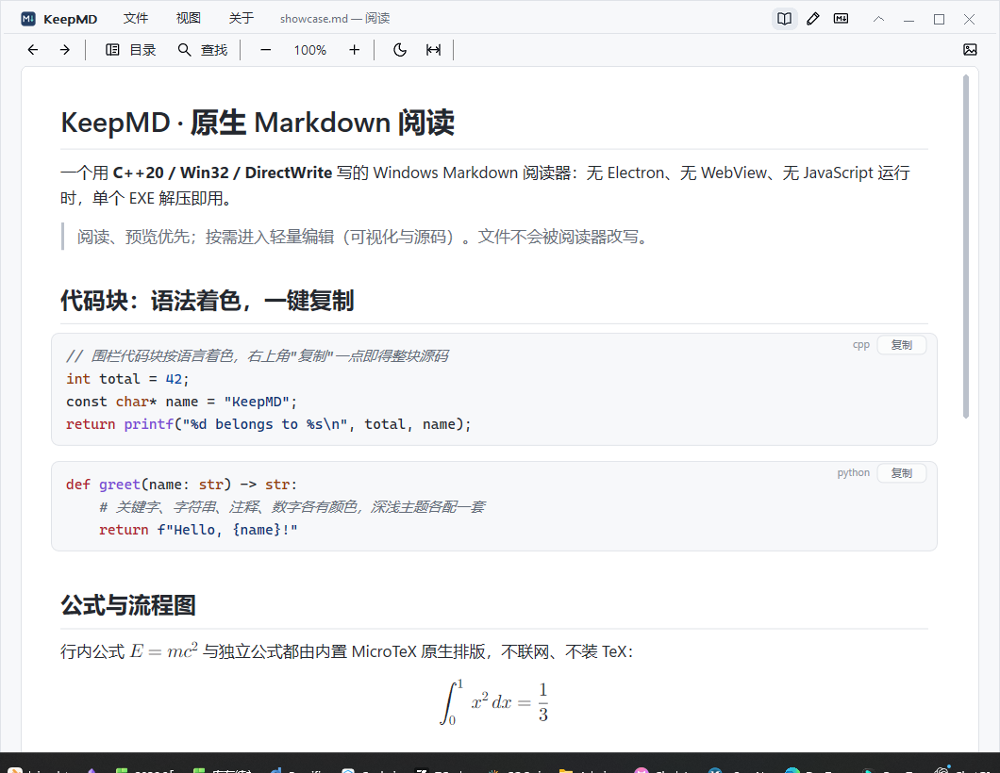
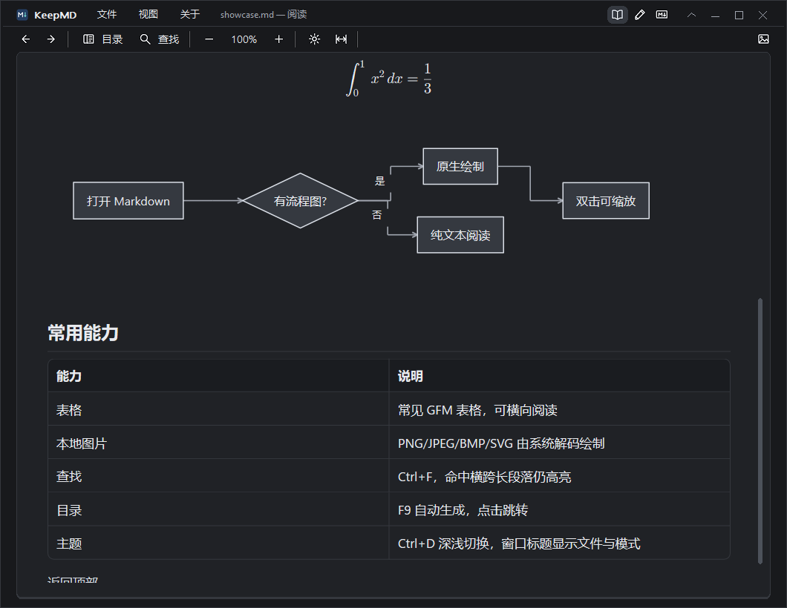
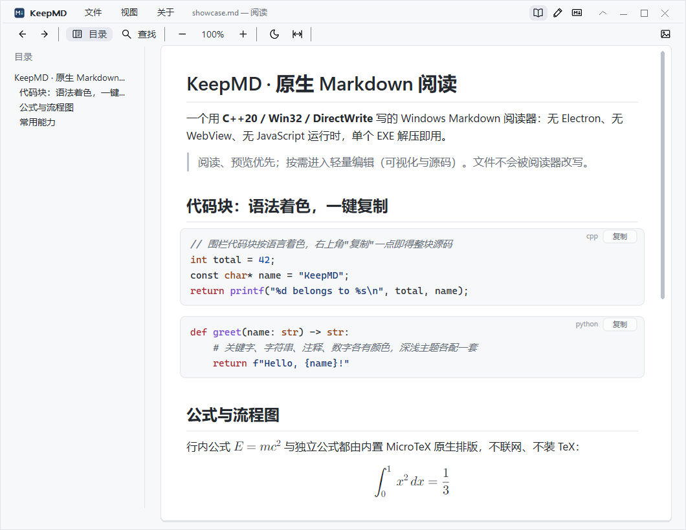
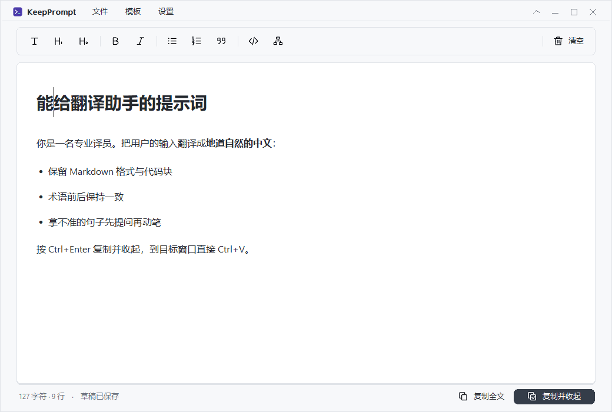

<div align="center">


# KeepMD

**原生 Windows Markdown 阅读器，附独立的快捷提示词工具**

C++20 · Win32 · DirectWrite · Direct2D · 单文件便携 EXE · 无 Electron / WebView / JavaScript 运行时

[](https://github.com/leiseek/KeepMD/releases/latest)
[](https://github.com/leiseek/KeepMD/releases/latest)
[](https://github.com/leiseek/KeepMD)
[](docs/VALIDATION.zh-CN.md)

*Native Windows Markdown reader and quick-prompt tool. Single portable EXE, no WebView.*
*下图均为真实程序截图：*

</div>

---



## 为什么是 KeepMD

打开一个 `.md` 文件，它应该**立刻可读**——像打开记事本一样快，像排版好的书一样好看。KeepMD 用纯 Win32 + DirectWrite 实现，不嵌入浏览器内核：

| | KeepMD | WebView 方案 |
| --- | --- | --- |
| 体积 | 单 EXE 2.7 MiB | 通常 100 MiB+ |
| 内存（闲置阅读） | ~16 MiB | 数百 MiB |
| 启动到首屏（温缓存） | p50 147 ms | 明显更慢 |
| 进程内依赖 | 仅 Windows 系统 DLL | 捆绑浏览器运行时 |

数据来自本机实测（Windows 11 x64，30 次取中位数），口径见[验证报告](docs/VALIDATION.zh-CN.md)。

## 功能一览

### 代码块：按语言着色，一键复制

17 种语言及常见别名（C、C++、C#、Java、JavaScript、TypeScript、Python、Rust、Go、JSON、YAML、Shell、PowerShell、SQL、CSS、HTML、XML）的关键字、字符串、注释、数字、函数调用各有颜色，注释斜体，深浅主题各配一套。着色只是显示层——**选择、查找、复制得到的仍是代码原文**。每个代码块右上角的「复制」按钮一点即得整块源码，并短暂显示「已复制」。

### 公式与流程图，全部原生排版

`$…$` 行内公式与 `$$…$$` 独立公式由内置 MicroTeX 排版、Direct2D 绘制——不联网、不用安装 TeX。Mermaid flowchart 由内置解析器转成原生图形，双击可在适应宽度与原始大小间切换。



### 更多阅读能力

- **目录**（F9）自动生成、点击跳转；**查找**（Ctrl+F）命中横跨超长段落仍然高亮
- 常见 GFM 表格、任务列表、引用、本地图片（PNG/JPEG/BMP/SVG）、README 常用 HTML 子集
- 网络图片默认不联网，工具栏开关一次加载并按 URL 持久缓存
- F11 全屏阅读：Space／方向键翻页，指针静止自动隐藏，适合演示与翻页笔
- 文件名与当前模式常驻标题栏（如 `fix1.md — 阅读`），任务栏同步



### 按需编辑：可视化与源码

F6 进入编辑：**可视化模式**直接编辑排版后的内容（标题、加粗、列表、代码、流程图），保存的始终是原样 Markdown；**源码模式**使用系统 RichEdit 控件，支持 UTF-8/UTF-16、LF/CRLF 混合换行原样保存。超大文档（>26 万字符）自动切到源码模式保持流畅。

## KeepPrompt：快捷提示词工具

同仓库的另一个独立程序，**与阅读器分开打包**。在任何应用里按 `Ctrl+Alt+Space` 唤起输入窗口，写好提示词后 `Ctrl+Enter` 复制并收起，回到目标窗口 `Ctrl+V`。可视化编辑、草稿自动保存、模板与托盘常驻，单 EXE 0.6 MiB。



## 快速开始

1. 从 [Releases](https://github.com/leiseek/KeepMD/releases/latest) 下载：
   - `KeepMD-x.y.z-windows-x64.zip` —— 阅读器
   - `KeepPrompt-x.y.z-windows-x64.zip` —— 提示词工具（按需）
2. 解压到任意可写目录，运行 `keepmd.exe`（或拖入 / 关联 `.md` 文件）。

```powershell
.\keepmd.exe .\README.md          # 打开文件
.\KeepPrompt.exe --show           # 提示词：立即输入
.\KeepPrompt.exe --resident       # 提示词：驻留托盘等待快捷键
```

### 常用快捷键

| 按键 | 功能 | 按键 | 功能 |
| --- | --- | --- | --- |
| `Ctrl+O` / `Ctrl+N` | 打开 / 新建 | `Ctrl+F` / `F3` | 查找 / 下一个 |
| `F9` | 目录 | `Ctrl+D` | 深浅主题 |
| `Ctrl+滚轮` | 缩放 | `F6` | 阅读 / 编辑 |
| `Ctrl+E` | 可视化 / 源码 | `Ctrl+S` | 保存 |
| `F11` | 全屏阅读 | `Ctrl+Shift+T` | 收起工具栏 |

完整列表见[使用说明](docs/USAGE.zh-CN.md)。

## 构建与验证

需要 Visual Studio C++ Build Tools（MSVC + Windows SDK）、CMake ≥ 3.25、Ninja、PowerShell 7。依赖源码已固定并随仓库提供，构建不需要联网下载：

```powershell
.\tools\build.ps1 -Test          # 构建并运行 283 项核心检查
.\tools\validate.ps1             # 全部 GUI 套件（会打开真实窗口）
```

每个版本发布前在同一组 EXE 上完成核心检查、全部 GUI 套件、基准、导入表审计（确认只依赖系统 DLL）与打包后真实启动验证；数据与边界如实记录在 [VALIDATION.zh-CN.md](docs/VALIDATION.zh-CN.md)。

## 项目文档

- [使用说明与支持范围](docs/USAGE.zh-CN.md) · [验证报告](docs/VALIDATION.zh-CN.md)
- [版本说明](docs/releases/) · [迭代记录](docs/ITERATION-LOG.md) · [路线图](ROADMAP.md)
- [KeepPrompt 与 Prompt Flow](docs/PROMPT-FLOW.zh-CN.md) · [技术调研](docs/RESEARCH.zh-CN.md)
- [第三方来源与许可证](THIRD_PARTY_NOTICES.md)

## 边界（不做什么）

阅读器是本项目重点。以下**不在**当前范围：完整 Mermaid、任意 HTML/CSS/JS、SVG 全特性（含文字/样式表的 SVG 显示占位与原因）、PDF/DOCX 导出、云同步、跨平台。公式只支持 MicroTeX 子集；Windows 10 与 ARM64 未实测；便携程序未签名。已验证与未验证的内容同样如实列出——见验证报告。

## 许可

源码与发布物随附第三方组件清单（MD4C、Tinta、MicroTeX、tinyxml2， licenses/ 目录含逐项许可证）。项目自身尚未声明开源许可证；引用或分发前请先阅读 [THIRD_PARTY_NOTICES.md](THIRD_PARTY_NOTICES.md) 并与作者确认。
