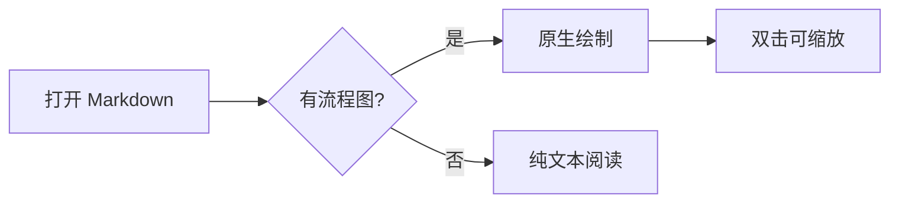

# KeepMD · 原生 Markdown 阅读

一个用 **C++20 / Win32 / DirectWrite** 写的 Windows Markdown 阅读器：无 Electron、无 WebView、无 JavaScript 运行时，单个 EXE 解压即用。

> 阅读、预览优先；按需进入轻量编辑（可视化与源码）。文件不会被阅读器改写。

## 代码块：语法着色，一键复制

```cpp
// 围栏代码块按语言着色，右上角"复制"一点即得整块源码
int total = 42;
const char* name = "KeepMD";
return printf("%d belongs to %s\n", total, name);
```

```python
def greet(name: str) -> str:
    # 关键字、字符串、注释、数字各有颜色，深浅主题各配一套
    return f"Hello, {name}!"
```

## 公式与流程图

行内公式 $E = mc^2$ 与独立公式都由内置 MicroTeX 原生排版，不联网、不装 TeX：

$$\int_0^1 x^2 \, dx = \frac{1}{3}$$



## 常用能力

| 能力 | 说明 |
| --- | --- |
| 表格 | 常见 GFM 表格，可横向阅读 |
| 本地图片 | PNG/JPEG/BMP/SVG 由系统解码绘制 |
| 查找 | Ctrl+F，命中横跨长段落仍高亮 |
| 目录 | F9 自动生成，点击跳转 |
| 主题 | Ctrl+D 深浅切换，窗口标题显示文件与模式 |

[返回顶部](#keepmd--原生-markdown-阅读)
